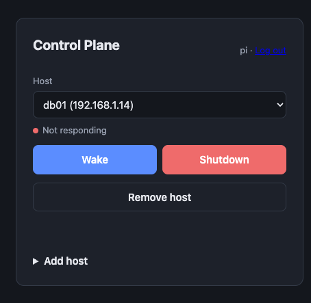

# Control Plane

A Python backend (FastAPI) with a small web page for powering hosts on and off: it sends magic packets to perform **Wake-on-LAN**, or connects over **SSH** and runs the `shutdown` command.

<p align="center">
  
</p>

## Usage

1. Create a user:
   ```bash
   uv run create_user.py <username>
   ```
2. Run the app:
   ```bash
   uv run fastapi dev main.py
   ```
3. Log in on the web page at http://127.0.0.1:8000.
4. Select a host to see its current status, then choose **Wake** or **Shutdown**.

## Shutdown setup

1. Create a user on the host for the app to log in as.
2. Create a key pair, copy the public key to the host, and export the private key path in the current environment:
   ```bash
   ssh-keygen -t ed25519 -f ~/.ssh/control_plane_key
   ssh-copy-id -i ~/.ssh/control_plane_key.pub <user>@<host>
   export CONTROL_PLANE_SSH_KEY=~/.ssh/control_plane_key
   ```
3. Give that user passwordless permission to run `shutdown`. On Linux, add this entry with `sudo visudo`:
   ```
   <user> ALL=(ALL) NOPASSWD: /sbin/shutdown
   ```
   Check the path with `command -v shutdown`; on some distros it is `/usr/sbin/shutdown`. Windows hosts don't need this step.

## Wake-on-LAN setup

- Make sure you have the host's MAC address.
- Enable Wake-on-LAN in the host's UEFI/BIOS.
- Run the app on the same local network as the host, since magic packets are broadcast and don't cross routers.

## Network view (TP-Link Archer)

The page can show your router's devices: who's online, connection band, current
download/upload, Wi-Fi link rate and signal, plus internet status and throughput. The data
comes from archer-monitor, a Prometheus exporter for the Archer A6 v4.

The app doesn't log in to the router itself. The router allows one admin session, and
archer-monitor holds it. The app reads archer-monitor's `/metrics` endpoint on the server
side and serves the result to logged-in users at `/api/network`.

1. Run archer-monitor (usually on the same Raspberry Pi).
2. Point the app at it:
   ```bash
   export CONTROL_PLANE_ARCHER_METRICS_URL=http://127.0.0.1:9105/metrics
   ```
   If the variable is unset, the Network section is hidden.

Devices whose MAC matches one of your saved hosts get a badge with the host's name.

## Tests

```bash
uv run pytest
```

## License

Released under the [MIT License](LICENSE).
